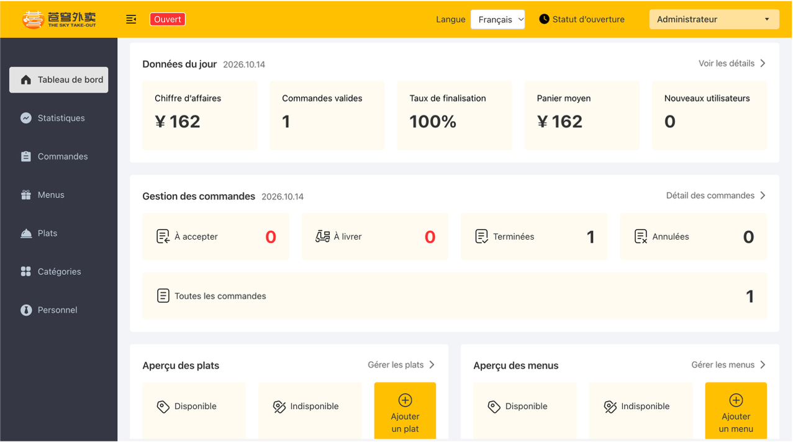
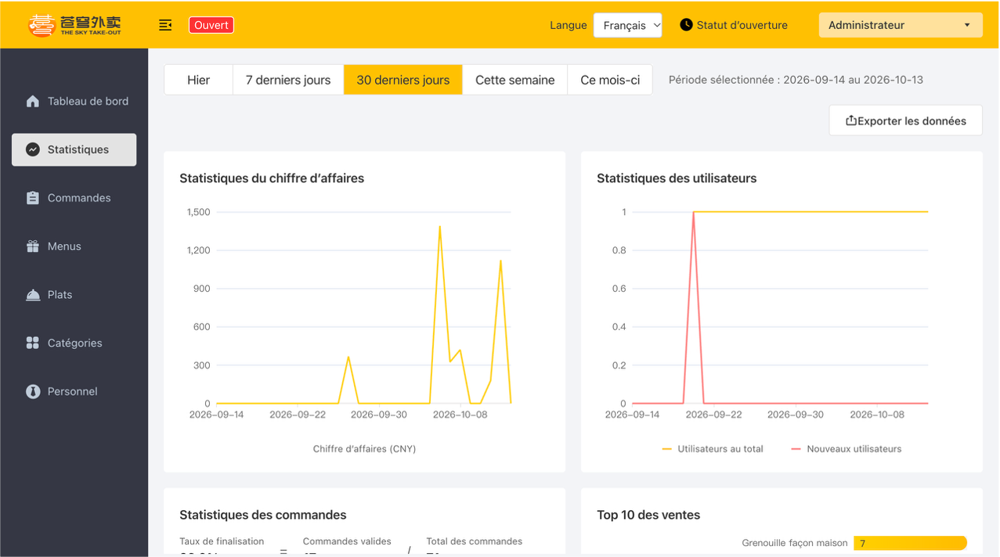
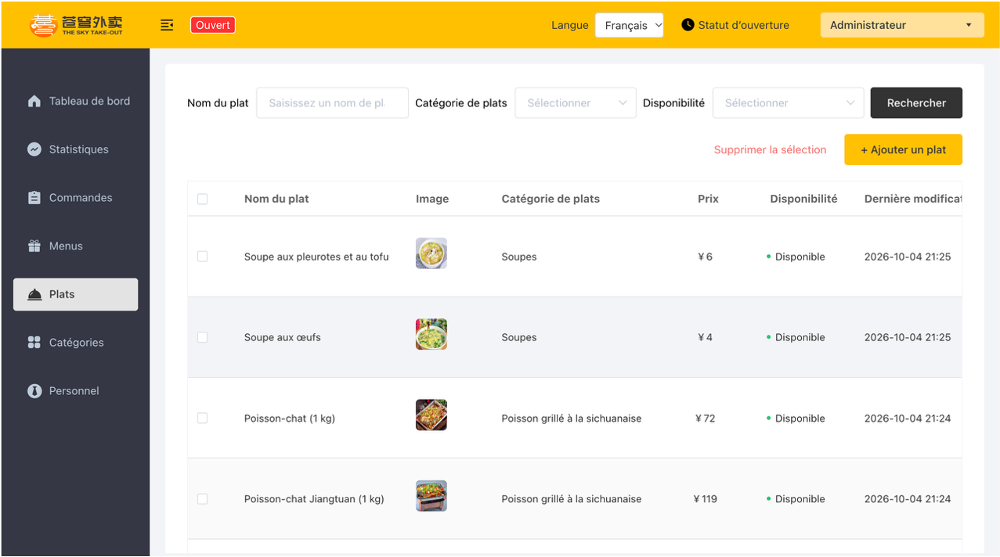
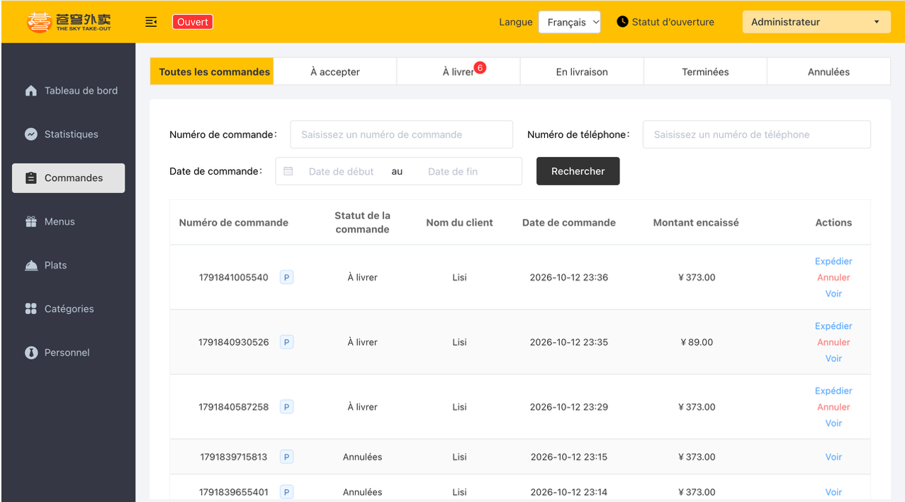
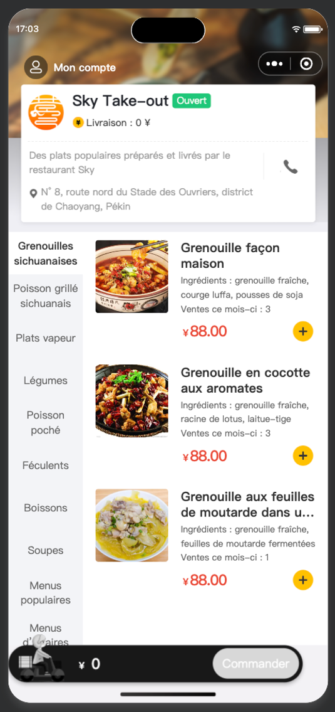
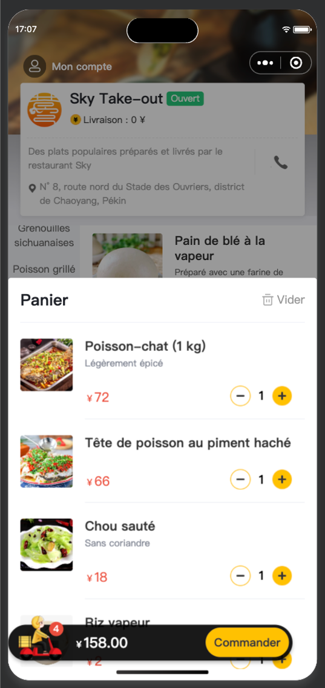
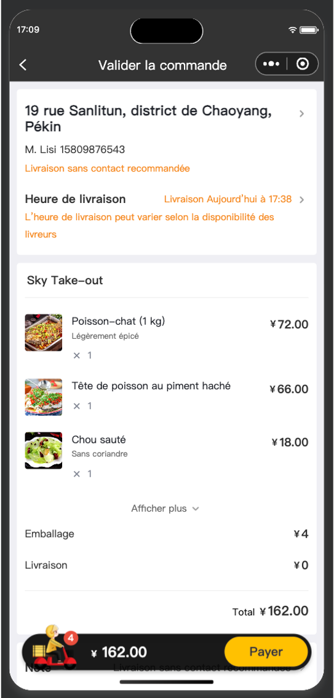
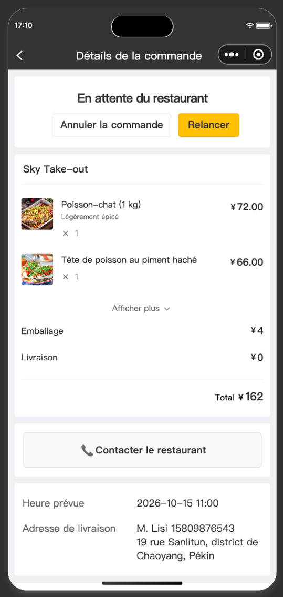
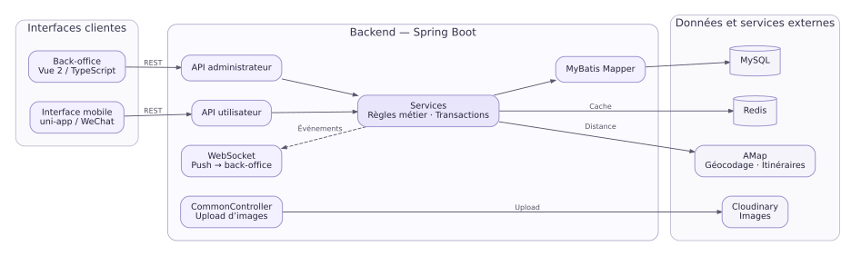

# Sky Takeout — Plateforme de commande et de livraison de repas

**Auteur : Liu Yang**

Sky Takeout est une plateforme métier de commande et de livraison composée d’une API REST Spring Boot, d’un back-office web et d’une interface mobile de commande. Le backend Java porte les règles de commande, de paiement, de livraison et de gestion du catalogue, avec MySQL pour les données et Redis pour le cache et l’état d’ouverture de la boutique. Le scénario correspond à la livraison de cuisine chinoise sur le marché chinois ; les données de démonstration et certains écrans contiennent donc des plats, noms et adresses en chinois.

## Réalisations backend

### Transitions de commande concurrentes

Les changements d’état reposent sur des mises à jour SQL conditionnelles qui vérifient les statuts attendus de la commande et du paiement. Elles sont exécutées dans les transactions métier et contrôlent le nombre de lignes modifiées afin qu’une confirmation de paiement tardive ne remplace pas une annulation déjà validée.

Le test d’intégration charge le véritable `OrderMapper.xml` contre MySQL et met en concurrence la confirmation du paiement et l’annulation pour expiration. Sur 100 exécutions, une seule transition est validée par concurrence et aucune incohérence entre l’état de commande et celui du paiement n’est observée. Les deux ordres d’exécution sont également vérifiés de manière déterministe. Le test dédié est [`OrderStatusRaceMySqlIntegrationTest.java`](sky-server/src/test/java/com/sky/mapper/OrderStatusRaceMySqlIntegrationTest.java).

### Pagination des commandes sans requête N+1

La page utilisateur conserve le comptage et le filtrage PageHelper, puis récupère en une requête groupée les détails des commandes de la page courante.

| Commandes par page | Requêtes SQL avant → après | Médiane avant → après |
| :--- | :--- | :--- |
| 10 | 12 → 3 (−75,0 %) | 10,398 → 9,072 ms (−12,8 %) |
| 20 | 22 → 3 (−86,4 %) | 12,666 → 9,123 ms (−28,0 %) |
| 50 | 52 → 3 (−94,2 %) | 18,663 → 9,611 ms (−48,5 %) |

Mesures locales sur MySQL 9.2.0 avec 10 000 commandes et 30 000 lignes de détail. Les temps couvrent le parcours Mapper/JDBC, après 30 préchauffages et sur 100 échantillons par taille de page. Le protocole et les résultats détaillés figurent dans le [rapport de performance](docs/performance/order-pagination.md).

### Cache de menu et invalidation après commit

Redis met en cache les plats et formules par catégorie. En cas de cache absent ou indisponible, les contrôleurs utilisateur chargent les données depuis MySQL ; un échec d’écriture dans Redis ne bloque pas la réponse. Après la validation d’une transaction qui modifie le catalogue, les services invalident les clés concernées. Une durée de vie avec variation aléatoire et des tentatives limitées d’invalidation réduisent les expirations simultanées et le risque de données périmées.

## Aperçu

### Back-office

<table>
  <tr>
    <td width="50%" align="center" valign="top">
      <strong>Tableau de bord</strong> 
       
      <a href="docs/screenshots/admin-dashboard-fr.png">Vue d’ensemble de l’activité du jour et disponibilité du catalogue</a>
    </td>
    <td width="50%" align="center" valign="top">
      <strong>Statistiques</strong> 
       
      <a href="docs/screenshots/admin-statistiques-fr.png">Évolution du chiffre d’affaires et des commandes, avec classement des plats</a>
    </td>
  </tr>
  <tr>
    <td width="50%" align="center" valign="top">
      <strong>Gestion du catalogue</strong> 
       
      <a href="docs/screenshots/admin-catalogue-fr.png">Administration des plats, de leurs prix et de leur disponibilité</a>
    </td>
    <td width="50%" align="center" valign="top">
      <strong>Gestion des commandes</strong> 
       
      <a href="docs/screenshots/admin-commandes-fr.png">Liste des commandes, montants et statuts</a>
    </td>
  </tr>
</table>

### Interface mobile de commande

<table>
  <tr>
    <td width="50%" align="center" valign="top">
      <strong>Menu</strong> 
       
      <a href="docs/screenshots/mobile-menu-fr.png">Consultation des catégories et des plats disponibles</a>
    </td>
    <td width="50%" align="center" valign="top">
      <strong>Panier</strong> 
       
      <a href="docs/screenshots/mobile-panier-fr.png">Articles sélectionnés, quantités et montant du panier</a>
    </td>
  </tr>
  <tr>
    <td width="50%" align="center" valign="top">
      <strong>Validation de commande</strong> 
       
      <a href="docs/screenshots/mobile-validation-fr.png">Vérification de l’adresse, des modalités de livraison et du récapitulatif</a>
    </td>
    <td width="50%" align="center" valign="top">
      <strong>Détail de commande</strong> 
       
      <a href="docs/screenshots/mobile-order-detail-fr.png">Suivi du statut et consultation du récapitulatif après validation</a>
    </td>
  </tr>
</table>

## Fonctionnalités

### Back-office

**Gestion opérationnelle** — Création, modification, recherche et activation ou désactivation des comptes employés ; gestion des catégories, plats, saveurs et formules ; suivi et traitement des commandes ; contrôle de l’ouverture de la boutique et notifications WebSocket après confirmation du paiement d’une commande.

**Tableau de bord** — Chiffre d’affaires des commandes terminées, attribué à leur date de création, nombre de commandes terminées, taux de réalisation, panier moyen, nouveaux clients, compteurs des commandes à confirmer, en attente de livraison, terminées et annulées, ainsi que disponibilité des plats et formules.

**Statistiques et rapports** — Tendances du chiffre d’affaires, des commandes et des nouveaux clients, classement des dix plats les plus vendus et export des données au format Excel.

### Interface mobile de commande

Consultation des catégories, plats et formules, choix des saveurs, panier, gestion des adresses, commandes immédiates ou programmées, suivi et historique. L’interface propose des libellés en français, anglais et chinois ; les noms de plats, catégories, formules et adresses restent des données métier.

### Règles métier

Transitions d’état des commandes contrôlées en base, vérification de la propriété des commandes et des adresses, clés JWT distinctes pour les espaces administrateur et utilisateur, calcul du montant côté serveur et validation des créneaux et de la distance de livraison.

## Architecture

Le backend est un **monolithe modulaire organisé en couches** : les contrôleurs REST exposent les opérations, les services appliquent les règles métier et les transactions, puis les mappers MyBatis accèdent à MySQL.

| Module | Responsabilité |
| --- | --- |
| `sky-server` | API REST Spring Boot, services et intégrations backend |
| `sky-pojo` | Entités, DTO et VO |
| `sky-common` | Configuration partagée, constantes, propriétés, exceptions et utilitaires |
| `admin-web` | Back-office Vue 2 et TypeScript |
| `mini-program` | Interface de commande uni-app pour WeChat |

La stack comprend Java, Spring Boot 2.7.3, MyBatis, MySQL, Redis, JWT et WebSocket ; le back-office utilise Vue.js et TypeScript, et l’interface client uni-app.

## Installation locale

Le guide [`docs/installation.md`](docs/installation.md) détaille l’initialisation MySQL, la configuration locale, le lancement de Spring Boot et Vue, ainsi que la compilation optionnelle du mini-programme.

## Vérifications

Le dépôt comprend des tests unitaires et des tests d’intégration MySQL ciblés. Les mesures de pagination et leur protocole sont décrits dans le [rapport de performance](docs/performance/order-pagination.md).

## Notes sur l’environnement de démonstration

- Le profil `dev` simule le paiement ; il ne réalise pas de transaction réelle.
- La connexion complète au mini-programme nécessite un AppID et un AppSecret WeChat valides.
- La validation de livraison par géocodage et itinéraire nécessite une clé Web Service AMap (`AMAP_KEY`).
- Les images des plats utilisent des URL Cloudinary externes ; leur affichage dépend de leur disponibilité.
